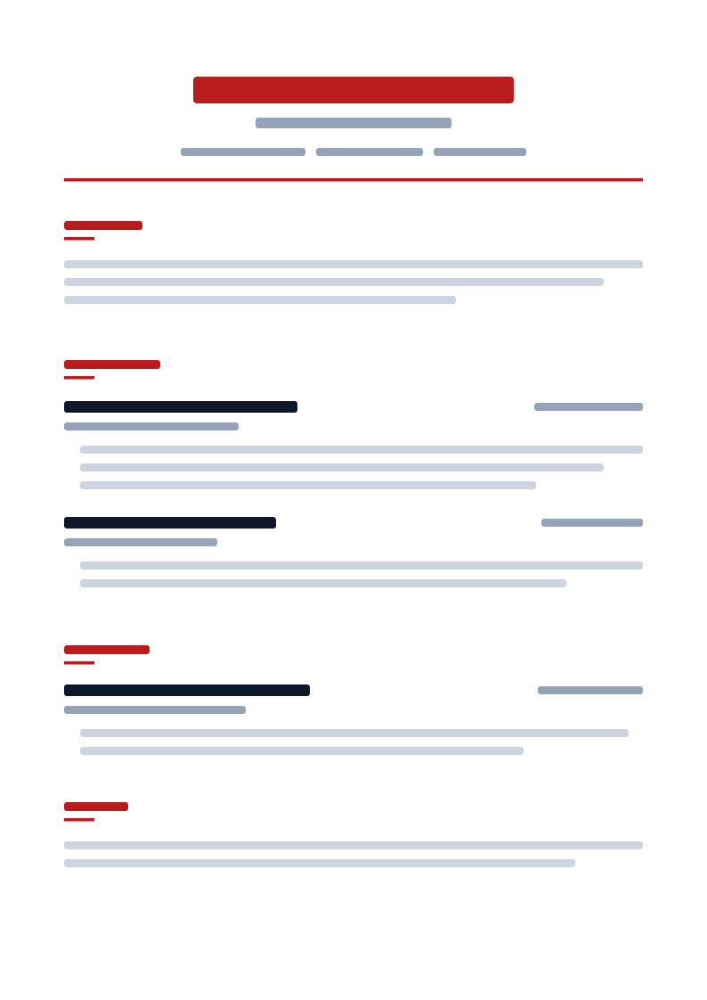
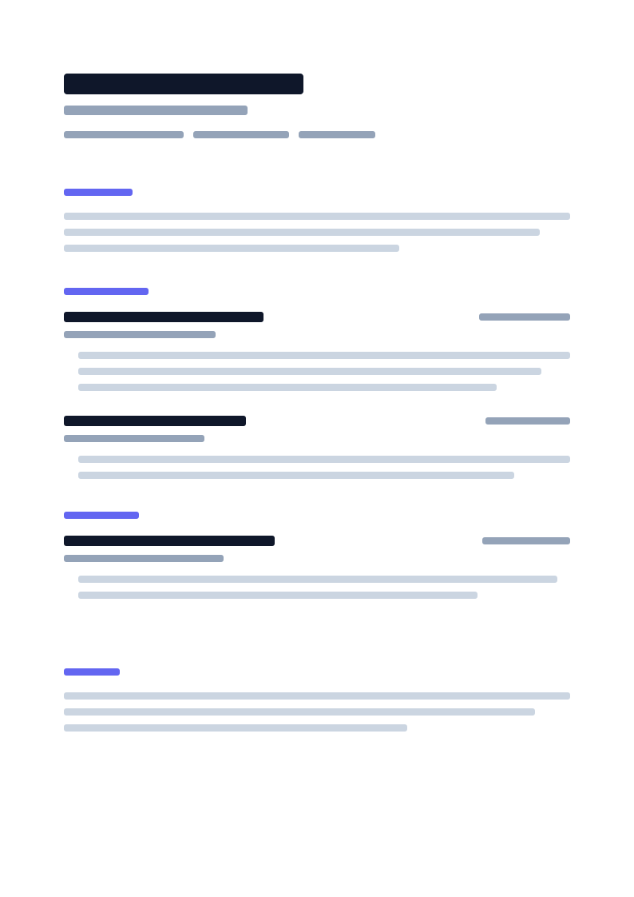

<div align="center">
  <a href="https://veriworkly.com">
    
  </a>

  <br />
  <br />

  <h1>VeriWorkly</h1>

  <p><strong>A privacy-first, open-source career workspace.</strong></p>

  <p>
    <a href="https://veriworkly.com">Website</a>
    ·
    <a href="https://docs.veriworkly.com">Documentation</a>
    ·
    <a href="https://blog.veriworkly.com">Blog</a>
    ·
    <a href="https://veriworkly.com/roadmap">Roadmap</a>
  </p>

  <p>
    
    
    
  </p>
</div>

---

## What VeriWorkly is

VeriWorkly is an open-source career workspace: a resume and cover letter editor, a portfolio website builder, an ATS checker and AI writing help. Everything starts from one Master Profile.

It is local-first. Documents live in your browser's `localStorage`, and you can build, edit and export with no account. Signing in adds cloud sync, sharing, AI features, ATS deep analysis and imports.

## Features

- **Local-first editor.** Resumes and cover letters save to the browser as you type. Guest mode is remembered by a 30-day `veriworkly-guest-mode` cookie, set in the browser with `document.cookie`.
- **Master Profile.** One record of your career history. New documents start from it; editing a document never changes it.
- **Portfolios.** Website templates Signal and Atelier (free, with a "Built with VeriWorkly" badge), Nimbus and Cipher (paid). Publishing is not yet enabled in production.
- **ATS checker.** A deterministic scan from the open-source [`@veriworkly/ats-engine`](https://www.npmjs.com/package/@veriworkly/ats-engine), plus optional AI analysis against a job description.
- **Exports in the browser.** PDF (`@react-pdf/renderer`), DOCX (`docx`), HTML, Markdown, plain text and JSON. No headless browser on the server.
- **Cloud sync.** Per-document sync to PostgreSQL with revision numbers, conflict detection and a "keep local only" option.
- **Developer API.** Scoped API keys and an OpenAPI reference at [docs.veriworkly.com/api-reference](https://docs.veriworkly.com/api-reference).

## Templates

<table width="100%">
  <tr>
    <td align="center" width="50%">
      
      <br /><strong>Precision ATS</strong>
    </td>
    <td align="center" width="50%">
      
      <br /><strong>Executive Clarity</strong>
    </td>
  </tr>
  <tr>
    <td align="center" width="50%">
      
      <br /><strong>Bold Impact</strong>
    </td>
    <td align="center" width="50%">
      
      <br /><strong>Modern Minimal</strong>
    </td>
  </tr>
</table>

The studio ships 7 resume templates and 5 cover letter templates.

## Repository layout

An npm workspaces monorepo: 6 apps and 2 shared packages.

```
veriworkly/
├── apps/
│   ├── site/            # Marketing site, port 3000 (Next.js 16)
│   ├── studio/          # Editor, Master Profile, ATS, billing, admin, port 3001 (Next.js 16)
│   ├── docs-platform/   # Documentation and API reference, port 3002 (Next.js 16, Fumadocs)
│   ├── blog-platform/   # Blog, port 3003 (Next.js 16, Fumadocs)
│   ├── portfolio/       # Portfolio builder and public portfolios, port 3004 (Next.js 16)
│   └── server/          # Express API, sync, billing, scheduled jobs, port 8080 (Node.js 22)
└── packages/
    ├── profile-core/    # Shared profile and document schemas (@veriworkly/profile-core)
    └── ui/              # Shared design system (@veriworkly/ui)
```

Each app has its own README with setup details, for example [`apps/studio/README.md`](apps/studio/README.md) and [`apps/server/README.md`](apps/server/README.md).

### Stack

| Part          | Technology                                                                     |
| :------------ | :----------------------------------------------------------------------------- |
| Frontends     | Next.js 16 (App Router), React 19, Tailwind CSS 4                              |
| UI            | `@veriworkly/ui`, in-house components                                          |
| Browser state | Zustand for UI state; documents saved by a hand-written `localStorage` service |
| Export        | `@react-pdf/renderer` and `docx`, in the browser                               |
| API           | Node.js 22, Express 4, TypeScript, clustered with `throng`                     |
| Database      | PostgreSQL with Prisma 7                                                       |
| Cache         | Redis 7: sessions, rate limits, quotas, view counts, job locks                 |
| Auth          | Better Auth: email one-time code, plus Google, GitHub and LinkedIn sign-in     |
| Payments      | Dodo Payments                                                                  |
| File storage  | Cloudflare R2, for portfolio images                                            |
| Docs and blog | Fumadocs and MDX                                                               |

## Run it locally

You need:

- Node.js 22.12 or later
- npm 11 (`npm@11.16.0`)
- PostgreSQL and Redis 7, for the API only

The site and the studio run without the API. The studio works in guest mode; sign-in and sync need the API.

1. Clone and install:

   ```bash
   git clone https://github.com/VeriWorkly/veriworkly.git
   cd veriworkly
   npm install
   ```

   `npm install` also generates the Prisma client (the root `postinstall` script).

2. Copy each app's environment file. Each app reads only its own `.env`.

   ```bash
   cp apps/server/.env.example apps/server/.env
   cp apps/site/.env.example apps/site/.env
   cp apps/studio/.env.example apps/studio/.env
   cp apps/portfolio/.env.example apps/portfolio/.env
   cp apps/docs-platform/.env.example apps/docs-platform/.env
   cp apps/blog-platform/.env.example apps/blog-platform/.env
   ```

   Every variable is described in the `.env.example` comments and in the app's README.

3. For the API: set `DATABASE_URL` and `REDIS_URL` in `apps/server/.env`, then apply the migrations:

   ```bash
   npm run db:migrate
   ```

4. Start what you need, each in its own terminal:

   ```bash
   npm run dev:site       # http://localhost:3000
   npm run dev:studio     # http://localhost:3001
   npm run dev:docs       # http://localhost:3002
   npm run dev:blog       # http://localhost:3003
   npm run dev:portfolio  # http://localhost:3004
   npm run dev:server     # http://localhost:8080
   ```

API health checks:

| URL                                       | Checks                                 |
| :---------------------------------------- | :------------------------------------- |
| http://localhost:8080/api/v1/health       | The API process answers                |
| http://localhost:8080/api/v1/health/ready | The API can reach PostgreSQL and Redis |

## Tests and checks

```bash
npm run lint
npm run format

npm test -w @veriworkly/server
npm run test:contracts -w @veriworkly/site
npm test -w @veriworkly/portfolio
npm test -w @veriworkly/ui

npm run test:contracts -w @veriworkly/studio
npm run test:browser -w @veriworkly/studio
npm run test:parity -w @veriworkly/studio

npm run build
```

The studio's browser and parity suites drive your installed Chrome (or Edge), not Playwright's bundled Chromium. See [`apps/studio/README.md`](apps/studio/README.md#tests).

## Documentation

| Topic        | Where                                                                                                                |
| :----------- | :------------------------------------------------------------------------------------------------------------------- |
| Overview     | [docs.veriworkly.com/docs/overview](https://docs.veriworkly.com/docs/overview)                                       |
| Architecture | [docs.veriworkly.com/docs/architecture/monorepo](https://docs.veriworkly.com/docs/architecture/monorepo)             |
| API          | [docs.veriworkly.com/api-reference](https://docs.veriworkly.com/api-reference)                                       |
| Local setup  | [docs.veriworkly.com/docs/getting-started/local-setup](https://docs.veriworkly.com/docs/getting-started/local-setup) |
| Docker       | [README.Docker.md](README.Docker.md)                                                                                 |
| Contributing | [CONTRIBUTING.md](CONTRIBUTING.md)                                                                                   |

## Contributing

1. Star the repository.
2. Claim an issue: comment on it and wait to be assigned before you start.
3. Name commits with conventional prefixes (`feat:`, `fix:`, `docs:`, `refactor:`).
4. Read [CONTRIBUTING.md](CONTRIBUTING.md) before you open a pull request.

## Security and privacy

- Guest documents are stored only in your browser. Signed-in users can keep any document local only.
- No heatmaps, mouse tracking or third-party behavioural tracking. Product metrics are aggregate only.
- Report security issues to `info@veriworkly.com`, not in a public issue. See [SECURITY.md](SECURITY.md).

## License

VeriWorkly is open-source software under the [MIT License](LICENSE).
